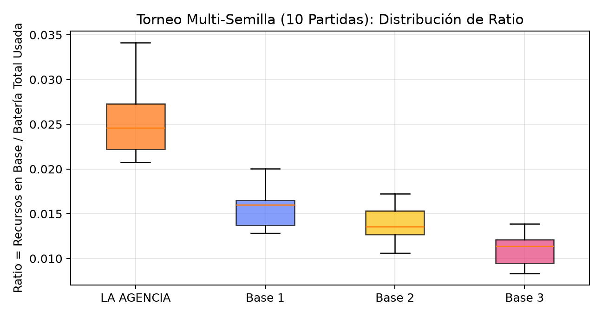
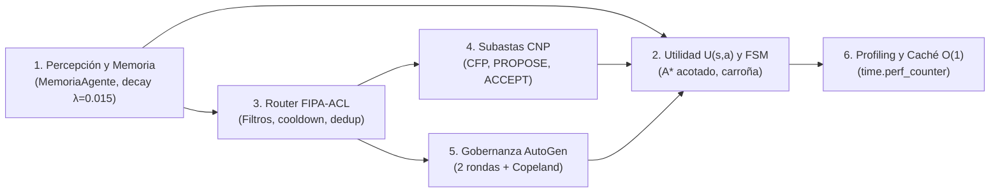

# Mars Multi-Agent Simulation — LA AGENCIA

[](https://www.python.org/)
[](https://www.pygame.org/)
[](LICENSE)

Simulación multiagente competitiva en Marte (`60×45`) desarrollada en Python/Pygame, junto con el diseño, implementación y validación experimental del agente autónomo descentralizado **LA AGENCIA** (`equipoA.py`).

**LA AGENCIA** hereda estrictamente de `EquipoBase` sin modificar el motor (`simulador.py`) ni la interfaz base (`equipo_base.py`), respetando la **regla de integridad arquitectónica**: cada unidad posee memoria espacial privada (`MemoriaAgente`) bajo niebla de guerra y toda comunicación remota fluye exclusivamente mediante mensajes estructurados **FIPA-ACL** con costo energético (`-0.5%` por envío y `-0.5%` por recepción).

---

## Resultados Destacados

En el torneo oficial de **10 partidas** alternando las cuatro esquinas del mapa (`A, B, C, D`) frente a tres rivales `EquipoBase`:

- **1.º lugar en 10/10 partidas** (`100%` de victorias).
- **Ratio promedio:** `0.02545` frente a `0.01563` del mejor oponente base (**`+62.8%`**).
- **Pico de rendimiento:** `0.0341` con `206 u.` de hielo depositado (Partida 3, semilla `134`).
- **Latencia en tiempo real (`< 40 ms/tick`):**
  - `200` unidades (`50`/equipo): media `1.221 ms`, `p99 = 11.184 ms` (`100%` bajo 40 ms).
  - `400` unidades (`100`/equipo): media `5.650 ms`, `p99 = 32.215 ms` (`99.8%` bajo 36 ms).



---

## Arquitectura Modular (6 Capas)



1. **Percepción y Memoria Espacial Individual (`MemoriaAgente`)**:
   - Creencias locales $O(1)$ para vetas de hielo (decaimiento exponencial $c(t) = e^{-0.015\Delta t}$, expiración a 120 ticks), restos energéticos (TTL 70 ticks) y tormentas con estimación de velocidad lineal $(v_x, v_y)$.
   - Invalidación activa dentro del radio de visión (`r=5` rovers, `r=9` exploradores, `r=7` recargadores).
   - Particionamiento dinámico de la grilla `60×45` con barrido compacto de 3 *waypoints* (`84.0%` de cobertura acumulada en los primeros 50 ticks).
2. **Utilidad Multi-Atributo, FSM por Rol y A\* Acotado**:
   - Máquinas de estados finitos explícitas: `EstadoRover`, `EstadoExplorador`, `EstadoRecargador`.
   - Función de utilidad $U(s, a) = w_1\hat{g}_{\text{hielo}} - w_2\hat{c}_{\text{despl}} + w_3\hat{o}_{\text{carroña}} - w_4\hat{r}_{\text{tormenta}}$ calibrada mediante **RL Policy Search (Cross-Entropy Method paralelo)**.
   - Vía rápida $O(1)$ sin tormentas y **A\* 8-direccional acotado a 28 expansiones** cuando una tormenta amenaza la ruta.
3. **Comunicación Estructurada FIPA-ACL**:
   - 8 performativas (`REQUEST`, `INFORM`, `CFP`, `PROPOSE`, `ACCEPT_PROPOSAL`, `REJECT_PROPOSAL`, `AGREE`, `FAILURE`) sobre 4 ontologías (`resource-discovery`, `rescue-ops`, `cnp-task`, `governance`).
   - Filtros anti-saturación que bloquean miles de envíos redundantes (`-32.8%` mensajes, `+6.1%` Ratio).
4. **Coordinación Contract Net Protocol (CNP)**:
   - Subastas descentralizadas con preselección de hasta $K=2$ candidatos y reservas temporales (`TTL=32` ticks) que evitan colisiones de rutas (`68` desplazamientos duplicados evitados en `seed=100`).
5. **Gobernanza Colectiva (Consenso tipo AutoGen + Copeland)**:
   - Deliberación no bloqueante (`< 0.2 ms`) cada 45 ticks entre 4 roles (`ExploradorJefe`, `OficialLogistica`, `OficialSeguridad`, `ModeradorConsenso`) en 2 rondas + desempate por puntuación de **Copeland** sobre 4 políticas globales (`EXPANSION_AGRESIVA`, `AHORRO_ENERGETICO`, `SUPERVIVENCIA_CARRONA`, `REPLIEGUE_FINAL`).
6. **Arquitectura No Bloqueante y Profiling**:
   - Cero `time.sleep`, cero I/O síncrono, estructuras $O(1)$ amortizadas e instrumentación interna con `time.perf_counter()`.

---

## Estructura del Repositorio

```text
.
├── simulador.py              # Motor gráfico y lógico de la simulación en Marte (Pygame)
├── equipo_base.py            # Clase base EquipoBase, constantes y contrato de percepción/comms
├── equipoA.py                # Implementación completa de LA AGENCIA (6 capas)
├── equipoB.py                # Equipo rival base B
├── equipoC.py                # Equipo rival base C
├── equipoD.py                # Equipo rival base D
├── benchmark_torneo.py       # Suite de torneo multi-semilla, ablaciones, profiling y generación de figuras
├── benchmark_equipoP.py      # Benchmark comparativo adicional
├── entrenar_la_agencia.py    # Calibración offline de hiperparámetros vía RL-CEM paralelo
├── Enunciado.pdf             # Enunciado oficial del proyecto
├── informe/                  # Informe técnico LaTeX/PDF, resultados JSON y figuras
│   ├── Informe_EquipoA.pdf
│   ├── Informe_EquipoA.tex
│   ├── figuras/
│   └── *.json
├── requirements.txt
└── LICENSE
```

---

## Instalación y Uso

### 1. Requisitos e instalación

```bash
python -m venv .venv
# Windows (PowerShell)
.venv\Scripts\Activate.ps1
# Linux / macOS
source .venv/bin/activate

pip install -r requirements.txt
```

### 2. Ejecutar la simulación interactiva

```bash
python simulador.py
```

**Controles en ventana:**
- `ESPACIO`: Pausar / Reanudar
- `+` / `-`: Cambiar velocidad de visualización (`1x`, `2x`, `4x`)
- `R`: Reiniciar partida
- `ESC`: Salir

### 3. Reproducir benchmarks y figuras

```bash
python benchmark_torneo.py
```

### 4. Re-entrenar pesos con RL-CEM paralelo

```bash
python entrenar_la_agencia.py
```

---

## Informe Técnico y Evidencia Experimental

Todos los detalles matemáticos, diagramas de secuencia, pruebas de ablación (FIPA-ACL, CNP, RL-CEM) y resultados crudos en JSON se encuentran en [`informe/`](informe/README.md), incluyendo el documento compilado [`informe/Informe_EquipoA.pdf`](informe/Informe_EquipoA.pdf).

---

## Licencia

Distribuido bajo licencia **MIT**. Consulta [`LICENSE`](LICENSE) para más información.
