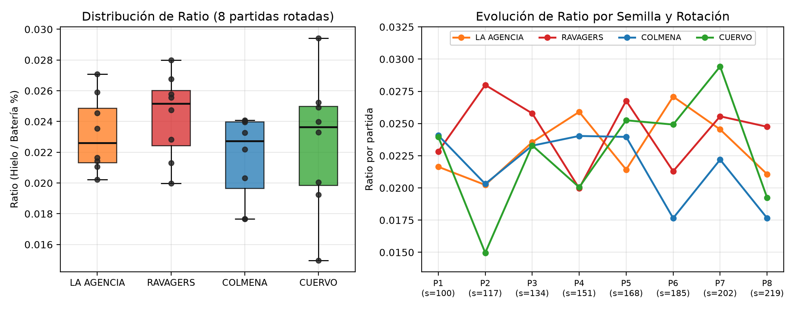
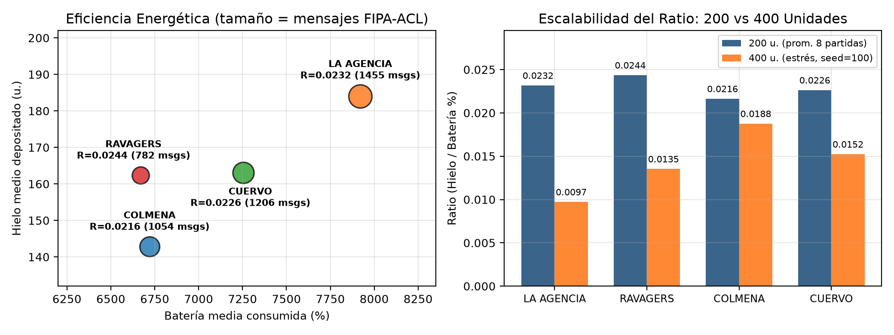
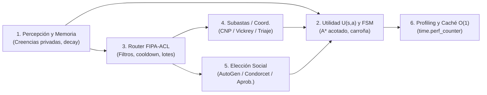

# Mars Multi-Agent Simulation — Ecosistema TB2 (4 Equipos Autónomos)

[](https://www.python.org/)
[](https://www.pygame.org/)
[](LICENSE)

Simulación multiagente competitiva en Marte (`60×45`) desarrollada en Python/Pygame, junto con el diseño, implementación y validación experimental de **cuatro facciones autónomas descentralizadas**: **LA AGENCIA** (`equipoA.py`), **RAVAGERS** (`equipoB.py`), **COLMENA** (`equipoC.py`) y **CUERVO** (`equipoD.py`).

Todas las facciones heredan estrictamente de `EquipoBase` sin modificar el motor (`simulador.py`) ni la interfaz base (`equipo_base.py`) —verificado mediante firmas **SHA-256**—, respetando la **regla de integridad arquitectónica**: cada unidad posee memoria espacial privada bajo niebla de guerra y toda comunicación remota fluye exclusivamente mediante mensajes estructurados **FIPA-ACL** con costo energético (`-0.5%` por envío y `-0.5%` por recepción).

---

## Los 4 Equipos Autónomos

| Facción | Archivo | Paradigma Core | Coordinación / Subastas | Elección Social / Gobernanza | Fortaleza Principal |
| :--- | :--- | :--- | :--- | :--- | :--- |
| **LA AGENCIA** | `equipoA.py` | Arquitectura modular de 6 capas calibrada con **RL-CEM** | **CNP** descentralizado (`K=2`, reservas TTL 32) | Consenso deliberativo **AutoGen** (2 rondas + Copeland) cada 45 ticks | Mayor volumen de hielo (`184.0 u.` en 4-Way; `10/10` vs. `EquipoBase`) |
| **RAVAGERS** | `equipoB.py` | **Blitz Central Agresivo** + Encadenamiento 5/5 + **Modo Reposo** | FIPA-ACL ultra-ligero sin sobrecarga de subastas | Modo Reposo reactivo por cuota (`140 u.` base / `10 u.` rover) + escuadrón élite | Mayor Ratio medio a 200 u. (`0.02437`, 4/8 victorias, solo `782` msgs) |
| **COLMENA** | `equipoC.py` | **Economía marginal $\Delta\text{Ratio}$** por anillos concéntricos ($R_1, R_2, R_3$) | **Subasta Inversa de Vickrey por Lotes** (*Batch Digest*, `2.62` vetas/msg) | **Condorcet / Copeland ponderado** por crisis cada 26 ticks | **1.º lugar bajo estrés 400 u.** (`0.01877`, `193 u.`) y menor `p99` |
| **CUERVO** | `equipoD.py` | **Enjambre fantasma rival-aware** + mapa de calor $5\times 5$ + estela de tormenta | **CNP Doble Mercado** (`hielo_sigilo`, `soporte_carrona`, `rescate`) | **Votación por Aprobación + Copeland** cada 45 ticks | Mayor supervivencia (`39.6/50`), pico absoluto (`0.02943`) y *hook* exclusivo en `consumiendo` |

---

## Resultados Destacados

### 1. Torneo Oficial 4-Way (`benchmark_torneo.py`, 200 unidades, 8 partidas con rotación A/B/C/D)

Las cuatro facciones autónomas logran victorias y superan ampliamente el techo de `EquipoBase` (`0.01563`):

| Facción | Victorias (1.º) | Pos. Media | Ratio Medio | Min–Max Ratio | Hielo (u.) | Batería (%) | Activas (/50) | Mensajes | `p99` (ms) | Máx (ms) |
| :--- | :---: | :---: | :---: | :---: | :---: | :---: | :---: | :---: | :---: | :---: |
| **RAVAGERS** | **4** | **2.00** | **0.02437** | `0.0200–0.0280` | 162.4 | **6669.9** | 26.3 | **782** | 7.251 | **13.373** |
| **LA AGENCIA** | 2 | 2.50 | 0.02318 | `0.0202–0.0271` | **184.0** | 7920.4 | 25.5 | 1455 | 10.357 | 17.414 |
| **CUERVO** | 1 | 2.50 | 0.02264 | `0.0150–0.0294` | 163.1 | 7253.8 | **39.6** | 1206 | 8.414 | 15.580 |
| **COLMENA** | 1 | 3.00 | 0.02165 | `0.0177–0.0241` | 142.9 | 6720.4 | 38.4 | 1055 | **7.055** | 13.577 |



### 2. Prueba de Estrés 4-Way a 400 Unidades Concurrentes (`100`/equipo, `seed=100`, 1200 ticks)

Bajo congestión extrema, el ranking se invierte a favor de los mecanismos económicos de control de congestión (**COLMENA** y **CUERVO**), manteniendo las cuatro facciones muy por debajo del presupuesto de tiempo real (`< 40 ms/turno`):

| Facción | Pos. | Ratio | Hielo (u.) | Batería (%) | Activas (/100) | Media (ms) | `p99` (ms) | Máx (ms) |
| :--- | :---: | :---: | :---: | :---: | :---: | :---: | :---: | :---: |
| **COLMENA** | **1.º** | **0.01877** | **193** | **10282.0** | **81** | 1.804 | **8.336** | 25.741 |
| **CUERVO** | 2.º | 0.01524 | 168 | 11022.5 | 75 | 1.920 | 12.195 | 14.926 |
| **RAVAGERS** | 3.º | 0.01354 | 156 | 11524.5 | 66 | **1.118** | 9.648 | **14.796** |
| **LA AGENCIA** | 4.º | 0.00973 | 115 | 11816.0 | 70 | 1.698 | 15.699 | 21.314 |



### 3. Benchmark Base (`benchmark_equipoP.py`, LA AGENCIA vs. 3 `EquipoBase`, 10 partidas)

- **1.º lugar en 10/10 partidas** (`100%` de victorias).
- **Ratio promedio:** `0.02545` frente a `0.01563` del mejor oponente base (**`+62.8%`**).
- **Pico de rendimiento:** `0.0341` con `206 u.` de hielo depositado (Partida 3, semilla `134`).
- **Ablaciones verificadas (`seed=100`):** Filtros FIPA-ACL bloquean `7611` envíos (`-32.8%` mensajes, `+6.1%` Ratio); CNP evita `68` desplazamientos duplicados; cobertura alcanza `84.0%` en 50 ticks.

---

## Arquitectura Modular de Referencia (6 Capas)



---

## Estructura del Repositorio

```text
.
├── simulador.py              # Motor gráfico y lógico de la simulación en Marte (Pygame)
├── equipo_base.py            # Clase base EquipoBase, constantes y contrato de percepción/comms
├── equipoA.py                # LA AGENCIA — 6 capas modulares + RL-CEM + CNP + AutoGen/Copeland
├── equipoB.py                # RAVAGERS — Blitz Central Agresivo + FIPA-ACL ligero + Modo Reposo
├── equipoC.py                # COLMENA — Anillos concéntricos + Batch Digest + Vickrey + Condorcet
├── equipoD.py                # CUERVO — Rival-aware 5x5 + Race Check + Hook D + CNP dual + Aprobación
├── benchmark_torneo.py       # Suite oficial 4-Way (8 semillas rotadas + estrés 400u + pruebas unitarias)
├── benchmark_equipoP.py      # Suite base LA AGENCIA vs. 3 EquipoBase (10 semillas, ablaciones y profiling)
├── entrenar_la_agencia.py    # Calibración offline de hiperparámetros vía RL-CEM paralelo
├── Enunciado.pdf             # Enunciado oficial del proyecto
├── informe/                  # Informe técnico LaTeX/PDF, resultados JSON y figuras
│   ├── Informe_EquipoA.pdf
│   ├── Informe_EquipoA.tex
│   ├── resultados_torneo_4way.json
│   ├── resultados_experimentos.json
│   ├── figuras/
│   └── *.json
├── requirements.txt
└── LICENSE
```

---

## Instalación y Uso

### 1. Requisitos e instalación

```bash
python -m venv .venv
# Windows (PowerShell)
.venv\Scripts\Activate.ps1
# Linux / macOS
source .venv/bin/activate

pip install -r requirements.txt
```

### 2. Ejecutar la simulación interactiva

```bash
python simulador.py
```

**Controles en ventana:**
- `ESPACIO`: Pausar / Reanudar
- `+` / `-`: Cambiar velocidad de visualización (`1x`, `2x`, `4x`)
- `R`: Reiniciar partida
- `ESC`: Salir

### 3. Reproducir benchmarks

```bash
# Torneo oficial 4-Way (verificación rápida + 8 partidas rotadas + estrés 400u)
python benchmark_torneo.py --quick --full

# Suite base de LA AGENCIA vs. 3 EquipoBase (10 partidas, ablaciones y figuras)
python benchmark_equipoP.py --quick --full
```

### 4. Re-entrenar pesos con RL-CEM paralelo

```bash
python entrenar_la_agencia.py
```

---

## Informe Técnico y Evidencia Experimental

Todos los detalles matemáticos, diagramas TikZ, comparativa de los 4 equipos, pruebas de ablación y resultados crudos en JSON se encuentran en [`informe/`](informe/README.md), incluyendo el documento compilado [`informe/Informe_EquipoA.pdf`](informe/Informe_EquipoA.pdf).

---

## Licencia

Distribuido bajo licencia **MIT**. Consulta [`LICENSE`](LICENSE) para más información.
